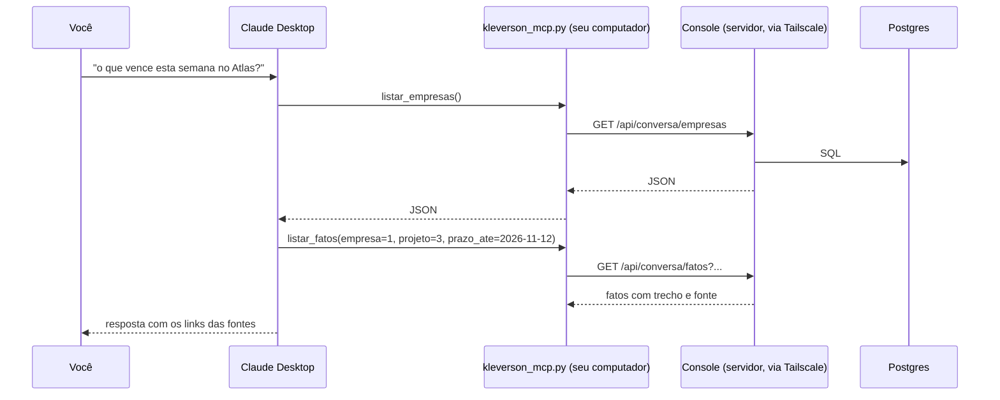

# 21. Conversar com os dados pelo Claude (MCP)

Este guia explica o **bloco 7**: perguntar ao Claude, no app dele, coisas como "o que
vence esta semana no projeto Atlas?" ou "o que a Márcia disse sobre o orçamento?", e ter a
resposta tirada dos seus dados, com a fonte. O código está em três lugares:

| Onde | O que faz |
| --- | --- |
| `mcp_local/kleverson_mcp.py` | o **servidor MCP local**, que roda no seu computador dentro do Claude Desktop (ou do Claude Code) |
| `app/routes_conversa.py` | a **API** do console que ele chama (`/api/conversa/...`), com a proteção |
| `app/conversa.py` | as **consultas** (SQL), com as regras: uma Empresa por vez, sempre com a fonte |

## 21.1 O que é MCP, em uma frase

O **Model Context Protocol** é o padrão aberto com que o Claude chama ferramentas de
fora. Um "servidor MCP" é um programa que diz ao Claude "eu tenho estas ferramentas, com
estes parâmetros", e o Claude decide sozinho quando chamar cada uma durante a conversa.

O caminho de uma pergunta:

## 21.2 Decisão: onde roda o servidor MCP

> [!success] Decisão: servidor MCP local, falando com o console pelo Tailscale
> Avaliamos os caminhos **A — conector remoto do claude.ai, com o MCP no servidor** e
> **B — servidor MCP local, no seu computador, chamando o console pela rede Tailscale**,
> e optamos por **B** pelos seguintes motivos:
> - O conector remoto é chamado **pelos servidores da Anthropic**, não pelo seu
>   computador. Para funcionar, o console teria de ficar acessível na internet, o que
>   quebra a regra número um do projeto ("nada público na internet").
> - No caminho B, quem chama o console é o seu computador, pela rede privada e com o seu
>   login do Tailscale, exatamente como o navegador. Nenhuma porta nova é aberta.
> - O programa local é **fino**: não tem banco, senha nem regra de negócio. Toda regra
>   fica no servidor, onde há testes com o banco de verdade. Se o programa local tiver
>   um bug, o pior que ele faz é perguntar errado; ele não consegue ver o que a API não
>   entrega.

O custo do caminho B: a conversa só funciona num computador com o Tailscale ligado e o
programa configurado. No celular (app do Claude), não há como rodar um MCP local, então
não funciona. Isso é aceitável enquanto o console não puder ficar na internet.

## 21.3 Decisão: qual app do Claude

> [!warning] Ponto de atenção: Claude Desktop no Linux é beta
> O Claude Desktop para Linux saiu em **beta em julho de 2026**, oficialmente para
> Ubuntu 22.04+ e Debian 12+. O Linux Mint é baseado no Ubuntu e deve funcionar, mas não
> está na lista testada pela Anthropic. O plano B é o **Claude Code** (no terminal), que
> é suportado oficialmente no Linux e usa o mesmo programa local, sem mudar nada no
> código. O guia de instalação (setup 22) traz os dois.

A conversa usa a **assinatura** do Claude, não a chave da API. Por isso o servidor não
gasta nada do teto de US$ 10 nesta parte. Isso foi decidido no início do projeto
("interface principal: console mínimo e o Claude via MCP").

> [!warning] Ponto de atenção: de quem é a conta
> Tudo o que as ferramentas devolvem entra na conversa e fica no histórico **da conta do
> Claude que você usar**. Se for a assinatura da sua esposa, os dados dos seus clientes
> ficam na conta dela. Além disso, em contas pessoais (Free, Pro, Max), a Anthropic pode
> usar as conversas para treinar modelos **se a opção estiver ligada**: desligue em
> Configurações → Privacidade antes de conectar. Na API e nos planos de empresa, isso
> não acontece por padrão.

## 21.4 As oito ferramentas

| Ferramenta | O que devolve | Escreve? |
| --- | --- | --- |
| `listar_empresas` | Empresas, projetos, fatos abertos por tipo e alertas abertos | não |
| `buscar` | itens (e-mail, transcrição, Drive) e anexos com as palavras, com trecho | não |
| `listar_fatos` | tarefas, decisões, riscos, prazos..., com trecho literal, responsável, quem disse | não |
| `alertas_abertos` | alertas de liderança abertos, uma linha por fato | não |
| `briefing` | o briefing de um dia, como foi montado às 7h | não |
| `reunioes` | reuniões num período, com participantes e transcrições | não |
| `ler_fonte` | o texto de um item ou de um anexo, em páginas | não |
| `por_na_agenda` | cria o evento do prazo de um fato (regras do PR #22) | **sim** |

**Por que só uma ferramenta escreve:** ler é seguro, e o pior resultado é uma resposta
errada, que você confere pela fonte. Escrever tem efeito fora do sistema. "Pôr na agenda"
entrou porque já existia com regras fortes (evento de dia inteiro, livre, particular, sem
convidados, com marca invisível e fácil de desfazer na página Na agenda). Resolver
alerta, criar fato ou mudar cadastro ficam no console, onde você vê o que está fazendo.
Além disso, o Claude Desktop pede a sua permissão antes de chamar uma ferramenta que
escreve (ela vem marcada como "não só leitura").

## 21.5 As três regras que valem para todas

1. **Uma Empresa por vez.** Toda ferramenta, menos `listar_empresas`, exige a Empresa. A
   consulta filtra por ela, e um id de outra Empresa (um projeto, um item, um fato)
   responde "não existe nesta Empresa", a mesma resposta de um id inventado. Assim nem a
   existência de um dado de outro cliente vaza. Esta é a premissa 5 e 6 do projeto
   ("toda busca de contexto para a IA filtra pela Empresa").
2. **Sempre com a fonte.** Todo resultado traz `fonte` com o tipo, o título, a data, o
   autor e o link da página do console. As instruções que o Claude recebe ao conectar
   dizem para citar a fonte de toda afirmação.
3. **Só fatos conferidos, salvo pedido.** Os fatos cujo trecho não foi achado no texto
   original (os "suspeitos", do PR #19) só aparecem com `incluir_suspeitos`, e as
   instruções mandam marcá-los como suspeitos.

## 21.6 Decisão: busca por palavra, não por significado (por enquanto)

> [!success] Decisão: busca por palavra com o próprio Postgres
> Avaliamos os caminhos **A — busca por significado (embeddings) com pgvector** e
> **B — busca por palavra (full-text search) do Postgres, sem acento**, e optamos por
> **B** nesta primeira versão pelos seguintes motivos:
> - A Anthropic não oferece embeddings. A busca por significado exigiria outro provedor
>   pago (o Voyage AI é o indicado por ela) e mandar **todo** o conteúdo coletado para
>   ele, não só o que for perguntado.
> - Quem pergunta é o Claude, não você. Ele já sabe reformular: se "orçamento" não acha,
>   ele tenta "custo" ou "budget". Boa parte da vantagem da busca por significado some.
> - Custo zero, nenhum serviço novo, e o índice cabe no banco que já existe.
> - **Revisitar** depois de algumas semanas de uso: se a conversa falhar em achar coisas
>   que estão lá, a busca por significado entra como uma ferramenta a mais, sem mudar as
>   outras.

Como a busca funciona (migração 0017):

- Cada item e cada anexo ganhou uma coluna `search_vector`, calculada pelo Postgres a
  cada gravação (**coluna gerada**). Ela guarda as palavras do texto reduzidas à raiz:
  "contratos" e "contrato" viram "contrat". Um **índice GIN** deixa a busca rápida.
- **Acentos:** o redutor de raiz do português precisa do acento ("aprovação" vira
  "aprov"), mas quem digita sem acento escreve "aprovacao". Por isso a coluna guarda as
  palavras de duas formas, com acento e sem acento (a configuração `kleverson_pt`, que
  passa o texto pela extensão `unaccent` antes). A pergunta também é feita das duas
  formas, unidas por OU. Resultado: com ou sem acento, de qualquer lado, acha.
- **Limitação conhecida:** plurais em -ão/-ões têm raízes diferentes ("reunião" e
  "reuniões"). As instruções do Claude mandam buscar os dois com OR.
- **Corte de 100 mil caracteres:** o Postgres recusa uma lista de palavras acima de 1 MB,
  e essa recusa travaria a gravação do item (o coletor pararia naquele arquivo). Com o
  corte, um arquivo gigante do Drive é gravado normalmente e só o que passa de 100 mil
  caracteres fica fora da busca. O texto inteiro continua no banco e em `ler_fonte`.
- A sintaxe é a de buscador (`websearch_to_tsquery`): `"frase exata"`, `OR` e
  `-palavra` para excluir.

## 21.7 A proteção da API

A API tem três camadas, explicadas no topo de `app/routes_conversa.py`:

1. **Tailscale:** igual a todo o console, só passa o seu login.
2. **Cabeçalho próprio (`X-Kleverson-Cliente: mcp`):** o problema que ele resolve é o
   "pedido forjado" (CSRF). Um site malicioso aberto no seu navegador consegue mandar um
   pedido simples para o endereço do console, e o Tailscale põe o seu login nele, porque
   o pedido sai do seu computador. Mas o navegador **não deixa** um site de fora pôr um
   cabeçalho próprio sem antes perguntar ao console (o "preflight" do CORS), e o console
   nunca autoriza. As páginas HTML usam outra defesa (a conferência da origem nos POST,
   do PR #4) porque elas são usadas pelo navegador; a API não é.
3. **Origem:** se o pedido trouxer o cabeçalho `Origin` (só navegadores mandam), ele
   precisa ser do próprio console.

Não há senha nova. Uma senha (token) no arquivo de configuração do Claude Desktop seria
mais uma coisa para vazar, e não protegeria nada que o Tailscale já não protege.

## 21.8 O diário registra o que saiu

Cada chamada fica no diário (página Processamento) com a ação `conversa.<ferramenta>`, a
Empresa e um resumo (a pergunta da busca, quantos resultados, qual item foi lido). O
motivo: o que a conversa lê **sai do servidor** para a Anthropic, e você deve conseguir
saber o quê. O diário não guarda as respostas inteiras, só o que identifica o pedido.

## 21.9 O que ficou de fora, e por quê

| Fora | Por quê | Quando revisitar |
| --- | --- | --- |
| Busca por significado | outro provedor pago e todo o conteúdo indo para ele (21.6) | se a busca por palavra falhar no uso |
| Resumo do briefing pelo Claude | agora você pede na conversa ("resuma o briefing de hoje"), sem custo fixo | — (resolvido pelo MCP, como o PR #21 previa) |
| Escrever além da agenda | efeito fora do sistema sem você ver a tela (21.4) | se fizer falta resolver alertas pela conversa |
| App do Claude no celular | não roda MCP local; o remoto exigiria o console na internet (21.2) | com o Workspace corporativo, se houver um caminho privado |
| Briefing marcado como lido ao ler pela conversa | a janela de "o que mudou" depende de você ter aberto a página | se você passar a ler só pela conversa |

## 21.10 Termos novos

| Termo | O que é |
| --- | --- |
| MCP | Model Context Protocol: o padrão com que o Claude chama ferramentas de fora |
| stdio | entrada e saída padrão de um programa; o Claude Desktop conversa com o MCP local por ela |
| ferramenta (tool) | uma função que o servidor MCP oferece, com nome, descrição e parâmetros |
| full-text search | busca por palavra que entende raiz ("contratos" acha "contrato") |
| tsvector / tsquery | no Postgres, as palavras de um texto e as de uma pergunta, prontas para comparar |
| coluna gerada | coluna que o banco calcula sozinho a partir de outras, a cada gravação |
| índice GIN | tipo de índice para "quais linhas têm esta palavra" |
| embeddings | números que representam o significado de um texto (a busca por significado) |
| CSRF | pedido forjado: um site de fora faz o seu navegador mandar um pedido em seu nome |
| PEP 723 | o bloco `# /// script` no topo de um arquivo Python, que diz ao `uv` quais bibliotecas ele usa |
